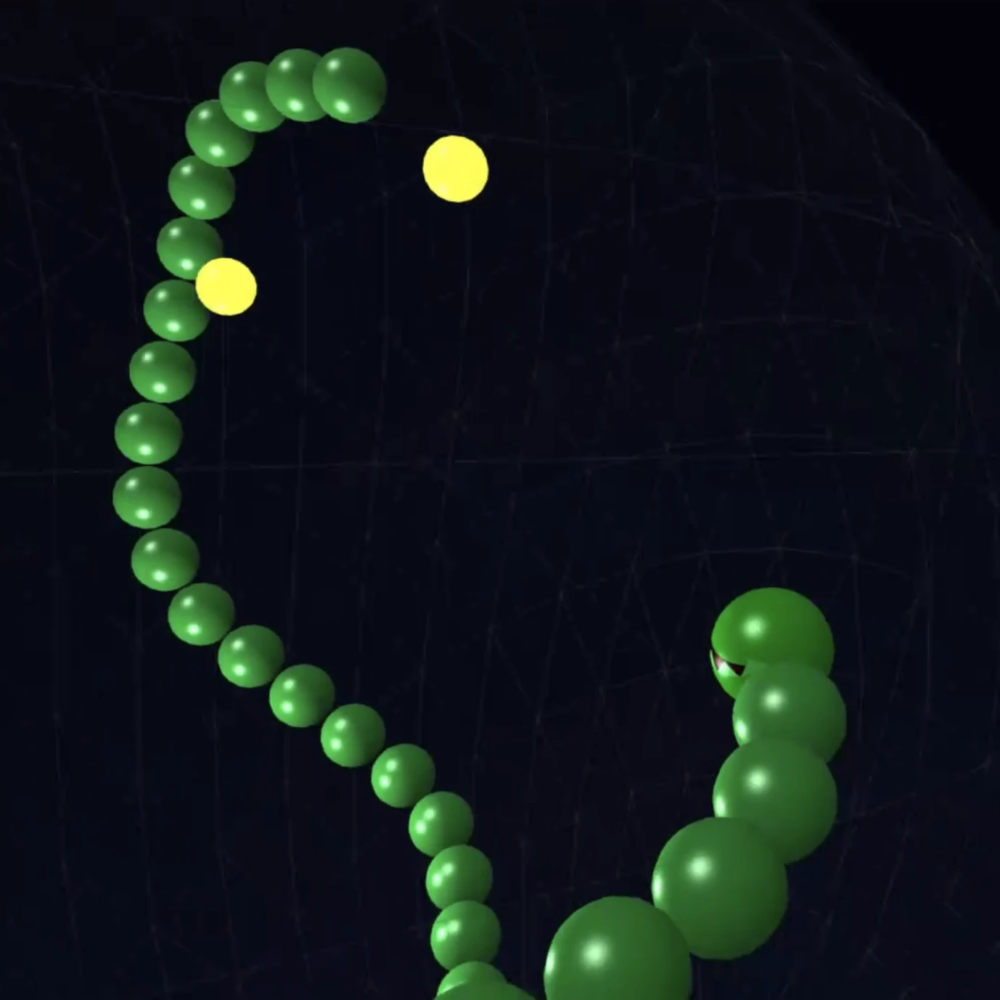

# 3D Snake

The classic game of Snake, moved inside a sphere: you steer in three dimensions, eat glowing dots and grow longer, and the longer you get, the harder it is not to crash into yourself.

<p align="center"></p>

- **Steer in every direction.** You always move forward, and you steer up, down, left and right with the keyboard or a gamepad.
- **Eat dots to grow.** Each dot scores a point and adds three segments, and a dot you pass close to slides toward your head.
- **Don't touch anything.** Running into your own body or the sphere's wall ends the run.

## Getting started

Play it in your browser at [gridloc.dev/games/3d-snake](https://gridloc.dev/games/3d-snake), or run it from source:

```bash
pnpm install && pnpm dev   # serve on http://localhost:5173
```

See [Getting started](docs/getting-started.md) for requirements and other ways to run it.

## Learn more

- [How to play](docs/features.md) · [Controls](docs/controls.md) · [Credits](docs/credits.md)
- [All documentation](docs/README.md) · [Working on the code](docs/development.md)

## License

[MIT](LICENSE)
